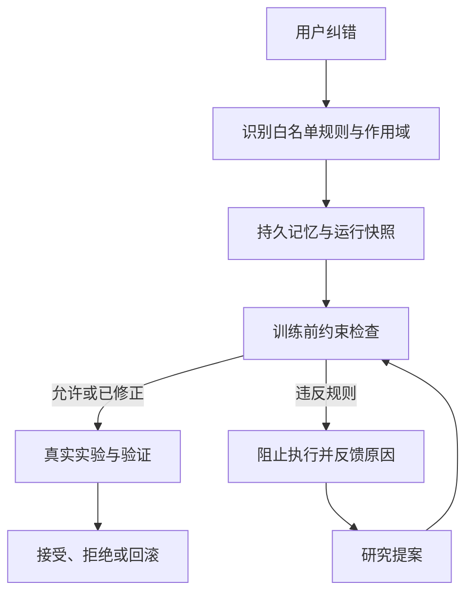

# 用户反馈驱动的自我更正：实现、验证与创新设计

## 本轮交付

系统现在会把明确的用户纠错要求保存为带作用域的执行约束。下次会话重新加载；即使提案仍然重复旧错误，训练前也会被阻止或修正。原有经验建议、策略演化与这类硬约束分开处理。

入口：`/research-agent` 的「你指出的问题，下次执行前检查」与「创新设计与实验证据」。原工作台的手动训练也接入相同纠错库，不能绕过已启用的约束。

## 1. 实际验证了什么

完整测试发现 357 项：**344 项通过，13 项真实 TCP 供应商夹具测试因环境限制跳过**。日志：`artifacts/asgi-regression-accepted.txt`。

本轮不再只直接调用 API 处理函数：使用标准 Starlette TestClient，实际经过 FastAPI 路由、参数校验、后台任务、状态读取、纠错 API、持久化、ZIP 导出和恢复流程。Windows 沙盒禁止本机 TCP，原 TestClient 的 asyncio 自唤醒 socketpair 会卡住，因此新增仅用于进程内测试的事件循环，用线程事件唤醒；它不能注册网络描述符，不用于生产，不修改系统配置，也不绕过网络限制。

扩大测试暴露了原安装包漏带两份 benchmark CSV。已从原项目恢复；`t1_missing` 的 SHA256 与已有 `known_leaks.json` 完全一致。与数据泄漏相关的原测试实际通过，没有通过改测试期望隐藏缺陷。

还发现执行器虽实际使用预处理开关，却没有把实际配置写回结果。本轮已补上，使纠错证据、实验指纹与复现参数一致。新增测试检查了真实拟合管线的输出维度，确认缺失指示确实进入训练，而不是只在记录上写 true。

浏览器 `file://` 视觉检查被工具协议策略拒绝，本机 TCP 也受限，因此没有声称完成浏览器实机交互或视觉验收。JS 语法、HTML 元素引用、静态资源存在性及静态资源 API 响应均已检查。

`tools/verify_single_model.py` 实际检查了服务器模型配置，结果为未配置凭据、0 次调用。因此本次不声称完成真实 LLM 能力、模型 token 节省或供应商账单验证。

## 2. 自适应纠错的受控消融

冻结协议后，使用种子 71 / 83 / 97，每份数据测试三类纠错，共 **9 个下一会话案例**。每个案例运行三个实验臂：无记忆、只把纠错放进提示词、持久化且执行前强制检查。提案刻意回放相同错误，以检验系统在模型不配合时是否仍能守住约束。

所有分类器真实训练；总计 **59 次训练**，测试集使用 **0 次**。这是系统执行约束的压力测试，不是三个真实 LLM 的能力对比。

| 错误类型 | 无记忆 | 只有提示词 | 持久化执行约束 |
|---|---:|---:|---:|
| 重复训练同一有效配置 | 3 | 3 | 0 |
| 使用用户明确禁用的模型 | 3 | 3 | 0 |
| 漏掉用户要求的缺失指示 | 6 | 6 | 0 |
| **执行错误总数** | **12** | **12** | **0** |
| 三类案例训练次数合计 | 21 | 21 | 15 |

负对照：只针对数据 A 禁用随机森林，对数据 B 没有产生误拦截，实际误拦截 **0 次**。每个约束在新的 CorrectionStore 对象中重新加载，验证跨会话生效。撤销、冲突、未知反馈、禁止付费调用、默认参数等价去重与旧入口绕行均另有回归测试。

| 质量指标（各 3 个种子平均验证宏 F1） | 纠错前 | 执行纠错后 | 解释 |
|---|---:|---:|---|
| 重复实验场景 | 0.895723 | 0.895723 | 省掉重复训练，质量保持一致 |
| 缺失指示场景 | 0.916614 | 0.924958 | 自动补齐预处理，实际质量有所改善 |
| 禁用随机森林场景 | 0.895723 | 0.845305 | 严格遵守用户限制缩小搜索空间，质量可能下降；不把遵从性改善混称为精度改善 |

独立重放 `feedback-learning-replay` 与首次 `feedback-learning-final` 的数据摘要、各臂错误数、训练次数和 F1 一致。源码快照摘要全部校验通过。墙钟记录在 JSON 中，但样本少，不据此宣称统计显著加速。

证据：`artifacts/feedback-learning-final/report.json`、`protocol.json`、每个案例的 `run.json`、持久化纠错事件 `*_memory.json`、`source/`；重放校验见 `artifacts/feedback-evidence-check.json`。

## 3. 如何让“下次不犯”成为可检查的约束



已支持：阻止等价重复实验、禁用指定模型、要求缺失指示、禁止付费模型调用、保护测试集。重复检测对有效默认参数进行归一化，例如逻辑回归 `{}` 与 `C=1,max_iter=1000` 是同一次实验。

全局规则与精确数据 SHA256 规则分开；新研究开始时固定快照，避免运行中改变一条臂的约束。原工作台手动训练每次也检查最新规则。原始反馈不拼入高权限提示词，只提供程序生成的受限规则描述，不能执行用户文本中的代码或更改标签、评分、验收门槛。

“系统做得不好”“请变聪明”等无法可靠转成检查项的反馈为 pending；不会假装已经学会。禁止全部模型、绕过预算或更改测试分数等要求不激活。用户可撤销规则，历史事件仍保留；撤销一条提醒不能撤销程序固有的测试集隔离。

保证的边界是：**在接入纠错执行器的入口，对已识别、已启用、作用域匹配的约束，在执行前确定性检查**。模型仍可能再次提出坏建议，但系统不会因此执行已被硬约束禁止的操作。不能保证所有自然语言问题、未知错误、外部独立程序或旧教学演示都永不出错；未接入此执行器的旧演示不是该保证的适用范围。

## 4. 可以展示的项目创新点

| 项目设计贡献 | 相比简单方案的差异 | 本项目证据 |
|---|---|---|
| 用户纠错编译为执行约束 | 不仅保存对话或提示词，还在训练前阻止错误操作 | 回放压力测试：12 次错误降为 0 |
| 带作用域、可撤销、可审计的跨会话记忆 | 不把一次反馈无条件推广到所有数据；未知和冲突不直接生效 | 重启测试、负对照误拦截 0、撤销及冲突测试 |
| 实验层与策略层双闭环 | 一次实验可拒绝，整个策略还须通过独立任务验收；两层都留痕和可回退 | 原两轮实验一轮升级、一轮拒绝；新增反馈也可撤销 |
| 约束、预算和证据共同传递 | 多角色共用一份预算；未知用量不冒充零费用；源码与数据都快照 | 共享预算回归、失败记账测试、源码及数据摘要重放校验 |

这些是本项目的设计与工程贡献，不是“全球首创”或已获论文证明的声明。也不是在线更新 LLM 权重；当前自适应发生在持久记忆、约束执行、规划策略与实验反馈层。

## 复现

已有依赖环境下：

```powershell
python tools/run_asgi_checks.py
python tools/evaluate_user_corrections.py --output artifacts/my-feedback-eval
python tools/verify_single_model.py
```

启动网页：运行 `start-research.ps1`，打开 `http://127.0.0.1:8002/research-agent`。单模型测试需要在服务器配置凭据，不把密钥写入网页、源码或反馈框。已有证据目录不能覆盖，重跑请使用新目录。

重放带用户纠错的研究导出包时，在 `source/` 中运行 `python tools/run_research_system.py --output replay --corrections-json ../evidence/protocol.json`。纠错规则会重新经白名单校验并写入新的本地记录，规则语义相同，记录 ID 重新生成。上传了开发数据时还需指定 `--development-csv ../evidence/development-upload.csv --target 目标列`。
