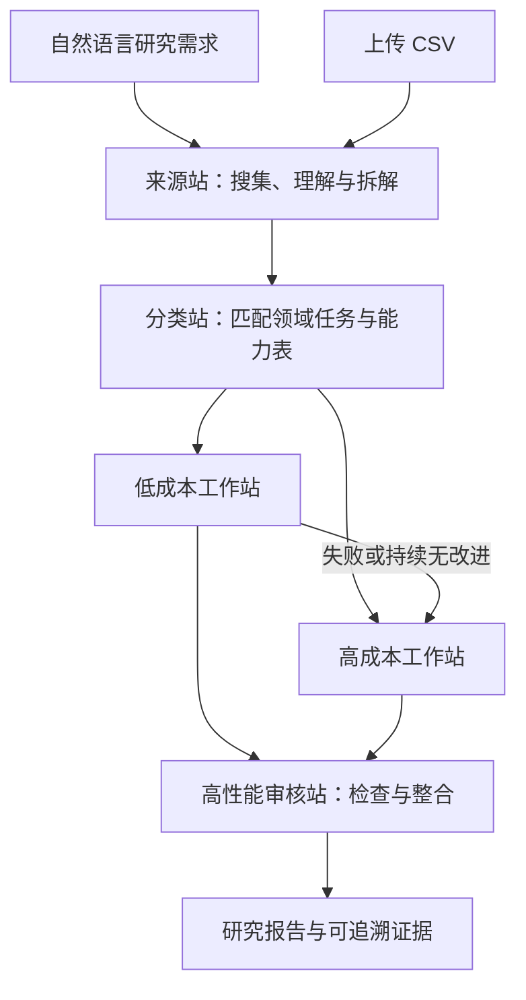

当前范围：仅保留来源采集、分类派发、低/高成本工作站、最终审核和报告导出。自进化与反馈学习暂停，默认服务不加载历史纠错记忆，不提供反馈接口或旧演示静态资源。

# 主链路：来源 → 分类派发 → 工作站 → 审核整合

本版只落地用户指定的机器学习主链路，不继续微调模型、部署千问或扩展旧演示。默认 `api:create_app` 已切换到新的精简应用。旧功能只保留在显式兼容工厂 `api:create_legacy_app`，不注册到主应用。



## 角色职责

| 站点 | 输入 | 输出与边界 |
|---|---|---|
| 来源站 | 自然语言需求或 CSV 的训练数据概况 | 搜索词、目录结果中的数据集选择、数据来源记录、研究任务卡；不编造数据 |
| 分类站 | 任务卡、数据概况、可配置能力表 | 固定类别与置信度；不解决任务、不调用训练、不决定预算 |
| 低成本站 | 被派发的简单任务与验证历史 | 有界模型/超参数/预处理提案，由实际 sklearn 执行 |
| 高成本站 | 低成本能力不支持的任务、实际失败或连续两次无改善的证据 | 复杂诊断与修复提案；仍受相同参数、训练与调用预算约束 |
| 高性能审核站 | 来源信息、任务结果、实际分数与失败记录 | approve/revise/reject、综合结论和真实实验引用；不能改写分数或编造实验 |

来源站与最终审核站可以使用同一个成熟模型，但请求职责分开。低成本与高成本模型由服务器配置；若实际配置为同型号，不宣称存在模型价格差。角色共同使用一份调用/token/时间台账，并给最终审核保留调用额度。

分类站采用现成 Jev Choice API 适配器，使用官方结构化分类协议；它不是专门微调过的机器学习领域模型。本项目通过机器学习任务类别与能力表限制它的工作范围，分类不确定时暂缓，不伪造结果。后续可替换成其他实现同一分类契约的现成分类模型。

## 数据搜集能力的实际范围

自然语言入口目前通过来源 LLM 操作 OpenML 公开机器学习目录：生成搜索词 → 调用真实目录搜索 → 从返回结果中选择 → 获取元数据并下载 CSV/ARFF。保留目录、下载地址、数据 ID、许可字段、选择理由与数据摘要。

此版为单表监督分类，不是任意互联网爬虫、付费数据源采集器或自动多表融合。仅允许 HTTPS OpenML 域名，拒绝任意/内网地址、重定向和超限文件。没有合适数据、缺少目标列或下载失败就停止，不用虚构样本补齐。

CSV 输入直接使用上传数据；来源模型读取训练统计与验证历史，工作站提出有界预处理/建模方案。不执行模型生成的任意 Python 代码。测试集不参与规划、分类派发或模型审核，只可在审核通过后按用户勾选最终评测一次。

## 服务器配置

不把任何密钥填到源码或网页。可共用 `ML_API_KEY`、`ML_BASE_URL`，模型身份分别设置：

- `ML_SOURCE_MODEL`：成熟来源/规划模型；可使用独立 `ML_SOURCE_API_KEY`、`ML_SOURCE_BASE_URL`。
- `ML_LOW_MODEL`：低成本工作站；可使用独立 `ML_LOW_API_KEY`、`ML_LOW_BASE_URL`。
- `ML_HIGH_MODEL`：高成本工作站；可使用独立 `ML_HIGH_API_KEY`、`ML_HIGH_BASE_URL`。
- `ML_REVIEWER_MODEL`：最终审核模型，默认与高成本站同型号；可使用独立 `ML_REVIEWER_API_KEY`、`ML_REVIEWER_BASE_URL`。
- `JEV_API_KEY` 或 `TYPESAFE_API_KEY`：分类站；`ML_CLASSIFIER_MODEL` 默认 `jev-latest`。

生成模型接口适配 OpenAI-compatible chat completions 协议；官方比赛接口到位后按其实际协议适配，不预设比赛允许使用哪些厂商。现有 `LIGHT_MODEL_API_KEY` / `DEEPSEEK_API_KEY` 仍可作统一凭据回退。

## 打开与测试

双击项目目录的 `双击打开机器学习.cmd`。打开 `http://127.0.0.1:8011/`，新端口避开旧演示进程。页面只有输入、工作站流转、预算、审核结果和证据导出。

验证命令：

```powershell
& "C:\workspace\EvoResearch\.venv\Scripts\python.exe" -m unittest discover -s tests -p test_ml_pipeline.py -v
```

12 项主链路测试通过：CSV、自然语言完整流程、搜集失败不造数据、低成本失败升级、置信度不足暂缓、能力不匹配、最终审核拒绝、审核额度保留、来源追踪及私有地址拒绝。测试使用替身模型/目录接口和真实 sklearn 训练，不代表外部 API 已在线验证。线上模型与 OpenML 实际搜集仍需在配置好的正常网络环境验收。

旧测试中的演示/API 用例针对旧兼容应用，不再是新主应用的功能要求；不把这些已移出主线的功能重新加回来只为保持旧页面测试通过。
